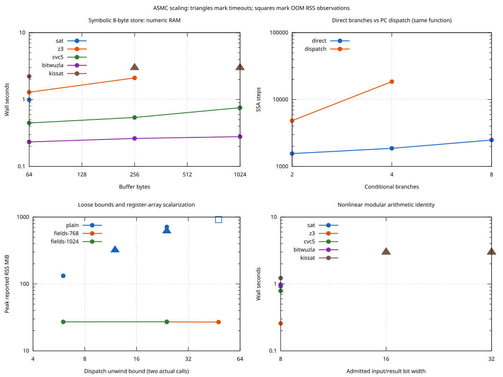

# What currently hurts ASMC scaling

Measured on an AMD Ryzen 7 PRO 7840U, using CBMC 6.11.0 and the project's pinned
SLEIGH/Ghidra 12.1.4. These are bounded, synthetic x86-64 checks, not a general
ranking of solvers. Most screening points use one repetition and a three-second
limit; selected confirmations use two repetitions and five/eight/ten-second
limits. All runs have a 1 GiB address-space cap per process. Raw model inputs,
commands and logs remain under `build/scaling-*`; compact measurements and
solver manifests are saved beside this report.

Triangles show runtime/RSS lower bounds for timed-out jobs; squares show RSS
observed before OOM. An available SSA
count is exact even if solving later times out; missing counts are omitted.
The [full measurement table](plots/summary.md) retains status counts and
successful-run medians. Timeouts are never counted as equivalence or replaced
with a fictitious completed time.

## Calls expose a representation problem, not merely a solver problem

The `call-bound` workload always executes **two calls**, with fixed stack depth.
Only the dispatch unwind bound changes:

| Encoding | Bound | SSA steps | Outcome | Reported peak RSS |
|---|---:|---:|---|---:|
| Default MiniSat | 6 | 4,332 | PASS, about 1.0 s | 133 MiB |
| Default MiniSat | 24 | 17,328 | Three-second timeout; longer repetitions gave one PASS at 6.67 s and one eight-second timeout | Up to 713 MiB |
| Field threshold 768 | 24 | 1,652 | Both longer repetitions PASS, 2.43–2.52 s | About 27 MiB |
| Default MiniSat | 48 | 34,656 | OOM after about 6.4 s under the 1 GiB address-space cap | About 919 MiB |
| Field threshold 768 | 48 | 1,652 | PASS, about 2.38 s | About 27 MiB |

CBMC defaults to array field sensitivity up to 64 elements. ASMC's register bank
is a flat **768-byte array**. Raising the threshold lets CBMC represent its bytes
as individual SSA fields. In the bound-24 logs, the default encoding expands 23
dispatch backedges, while the 768 setting expands four. This is evidence that
the representation affects propagation/control-flow pruning before solving.
It is consistent with better tracking of SP and stored return destinations;
it is not evidence of a faster SAT search alone.

The threshold has a real startup cost: tiny increments take roughly 0.9 s rather
than 0.2 s with the high setting. It also applies to data arrays, so there is no
universal threshold to enable by default. A useful next encoding experiment
would isolate the register bank into smaller groups or named scalar fields,
preserving byte aliases while avoiding global scalarization of buffers. A
threshold of 128, enough to scalarize this stack but not the register bank,
produced 120,177 SSA steps and still timed out at five seconds. The 768 setting
passed the same case. That
strengthens the case for targeting the register representation.

## Symbolic memory is sensitive to both backend and array shape

All of these write eight bytes and check read-after-write plus an unchanged
symbolic byte outside the written region:

| Buffer / encoding | Backend | Outcome |
|---|---|---|
| 1024-byte numeric RAM, symbolic offset | MiniSat | Three-second timeout, about 349 MiB reported RSS |
| Same | cvc5 | PASS, about 0.76 s in the screening run |
| Same | Bitwuzla | PASS, roughly 0.25–0.49 s across runs |
| 1024-byte numeric RAM, fixed offset | MiniSat | PASS, about 1.4 s |
| 64-byte C object, symbolic offset, default threshold | Bitwuzla | Screening timeout; an eight-second smoke run passed at 3.88 s |
| Same, array field sensitivity disabled | Bitwuzla | PASS, about 0.21 s |

The 64-byte object is at the default scalarization threshold, whereas a 1024-byte
object remains an array. Larger is consequently sometimes *faster* for SMT.
This is an encoding cliff, not a monotonic dependence on buffer capacity.

Confirmation runs on a 1024-byte C object make the tradeoff particularly clear:
plain Bitwuzla passed twice in about 0.32 s; threshold 768 passed twice in
1.13–1.47 s; threshold 1024 timed out twice at five seconds. The higher setting
scalarizes the data buffer as well as registers. Use `--max-field-sensitivity-array-size 0`
as a comparison for symbolic small buffers, and measure on the actual model.

Sixteen independent scalar C objects selected by a symbolic pointer remained
manageable in the read-only `objects` family (roughly 0.33 s). This does not
establish scalability for pointer graphs, writes, heap lifetimes or arbitrary
aliasing. Object count is only one variable.

## Dispatch and nonlinear arithmetic have different costs

For four independent branches in the same ELF, direct GOTO edges produce
1,866 SSA steps; `--dispatch` produces 18,544. MiniSat took roughly 0.5 s versus
3 s. Preserve direct branches when they work; the dispatch option is useful for
CFG structure/indirect targets, but can multiply work.

Kissat completed the eight-branch direct version in about 2.17 s, while the
other screened backends reached the three-second limit. A modern SAT solver
can help a Boolean-heavy workload without helping CBMC's formula construction.

The modular square identity is a solver-hard contrast: all five screened
backends finished the 8-bit case, but none finished the 16/32-bit cases within
three seconds. These jobs reached the decision procedure quickly with about
1,495 SSA steps. This is different from `dead-work-64`, which timed out in
symbolic execution before a solver was called. A backend change cannot fix
that front-end cost. The nonlinear result is a short-budget observation, not
a claim that these widths are infeasible with longer runs or other encodings.

## Some tempting knobs do not help, or fail the controls

- `--slice-formula` reduced some memory costs but did not eliminate the call-bound
  cliff. In the measured dead-work family it offered little benefit. The recorded
  SSA count is before slicing, so equal counts alone do not prove slicing did nothing.
- Dereference caching and early `goto-instrument --inline` did not resolve the
  padded-call case within the screening limit. Early inlining reduced some RSS.
- SAT with `--arrays-uf-always` failed the known-good increment and produced
  spurious return/ABI/functional failures. Its profile is rejected, not ranked.
  The same flag passed controls with Bitwuzla but offered little benefit for calls.
- Yices 2.6.5 passed the true control, then CBMC crashed while building the false
  control's trace in `simplify_expr.cpp`. This local solver/backend combination is
  rejected. A passing UNSAT check alone would have missed the problem.

The measured executables are Z3 5.1.0, cvc5 1.4.2, Bitwuzla
`0.4.0-dev-main@f361d3eb`, Yices 2.6.5 and Kissat 4.0.1, with built-in MiniSat.
They were already installed; none was installed by this experiment. Upgrading
the older Bitwuzla development build is worth a later controlled comparison,
but additional solvers are not necessary to reproduce the main findings.

## What to try next

1. Keep stack/RAM capacity explicit and inspect loop IDs. Choose smaller checked
   bounds; unwinding assertions must still pass.
2. Try threshold 768 for call-heavy models, and 0/default 64 for symbolic buffers.
   Inspect both time and memory; retain the setting only when it helps that model.
3. Compare MiniSat/Kissat on branch-heavy problems and Bitwuzla/cvc5/Z3 on memory.
   There is no measured universal winner and no automatic solver selection.
4. Prototype register-specific scalarization and word/byte-extract encodings as
   separate variants. Retain overlapping-register tests, native differential
   checks, memory bounds and corrupted-return counterexamples before adopting one.
5. For a large front-end cost, use CBMC's own profiling script to locate the
   hotspot rather than increasing solver time. For arithmetic-hard specifications,
   consider algebraic normalization or checked summaries as separate work.

The driver now exposes Bitwuzla, an external SAT executable, and the field
threshold. The lifter and defaults are unchanged.

## Relevant CBMC implementation details

All source links below are pinned to the CBMC commit used by these measurements,
`32441ee38f8b2be63281a88a0df1a585dd4fdc43`:

- [Array field sensitivity](https://github.com/diffblue/cbmc/blob/32441ee38f8b2be63281a88a0df1a585dd4fdc43/src/goto-symex/field_sensitivity.cpp)
  explains conversion of constant-index array members to separate SSA expressions.
- [Symex configuration](https://github.com/diffblue/cbmc/blob/32441ee38f8b2be63281a88a0df1a585dd4fdc43/src/goto-symex/symex_main.cpp)
  sets the default threshold and maps disabling field sensitivity to zero.
- [Solver factory](https://github.com/diffblue/cbmc/blob/32441ee38f8b2be63281a88a0df1a585dd4fdc43/src/goto-checker/solver_factory.cpp)
  shows that `--beautify` disables MiniSat's simplifier. Beautification is not
  included in the timing profiles.
- [BMC equation/solver stages](https://github.com/diffblue/cbmc/blob/32441ee38f8b2be63281a88a0df1a585dd4fdc43/src/goto-checker/bmc_util.cpp)
  explain the counters and phase timing boundaries.
- [GOTO transformations](https://github.com/diffblue/cbmc/blob/32441ee38f8b2be63281a88a0df1a585dd4fdc43/src/goto-instrument/goto_instrument_parse_options.cpp)
  explicitly warn that the constant propagator and full slicer may be unsound;
  they are excluded. Complexity/search cutoffs and disabling checks are also
  excluded from the proof-preserving comparison.
- [CBMC profiling](https://github.com/diffblue/cbmc/blob/32441ee38f8b2be63281a88a0df1a585dd4fdc43/scripts/profile_cbmc.py)
  provides perf/flamegraph tooling for pre-solver stages. It was inspected but
  not run in this experiment.
